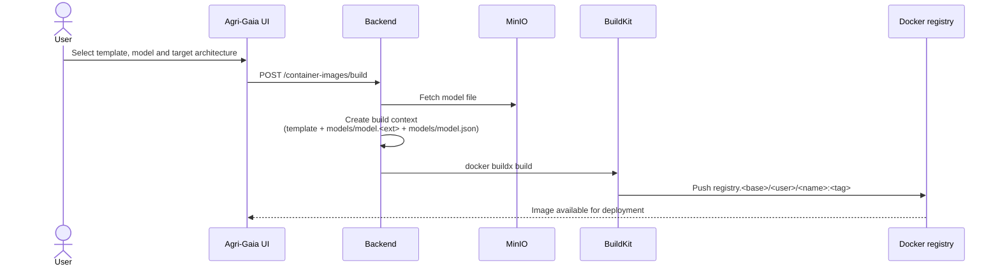

<div align="center">


# Agri-Gaia Inference Container Template

**Guidelines and a reference implementation for building custom inference containers with the Agri-Gaia platform.**

[](LICENSE)
[](#building-an-inference-image)
[](#model-metadata-file)
[](#building-an-inference-image)
[](#-reference-implementation)

[Requirements](#-building-a-custom-inference-container-template) ·
[Model Metadata](#model-metadata-file) ·
[Usage](#-using-a-template-in-the-platform) ·
[Reference Implementation](#-reference-implementation)

</div>

---

## 📖 Table of Contents

- [Overview](#-overview)
- [Building a Custom Inference Container Template](#-building-a-custom-inference-container-template)
- [Using a Template in the Platform](#-using-a-template-in-the-platform)
- [Reference Implementation](#-reference-implementation)
- [Related Repositories](#-related-repositories)
- [License](#-license)

## 🌱 Overview

This repository describes the templates from which the [Agri-Gaia platform](https://github.com/hsos-ai-lab/agri-gaia-platform) builds **inference containers**. An inference container template is a project with a `Dockerfile`. The platform combines it with a model selected by the user and builds a self-contained container image that serves the model. The image is pushed to the platform's Docker registry and can then be deployed to edge devices.



## 🧩 Building a Custom Inference Container Template

You can create a custom inference container template and add it to the platform. Only two requirements must be met:

### 1. A single `Dockerfile` at the root

The platform expects exactly one Dockerfile, named `Dockerfile`, in the root directory of the inference container template, so that it can build a Docker image from your project. The file tree should look like this:

```text
/Dockerfile
/rest-of-the-files
/possible-subdir/*
```

> [!NOTE]
> The presence of the root `Dockerfile` is the only check the platform performs when a template is added.

### 2. Copy the model into the image

During the build, the model you selected in the UI of the Agri-Gaia platform is copied into the **build context** of the image, so your Dockerfile can access it at build time. Next to the model, the platform also provides a metadata file with information about the model that can be useful for running it. The build context therefore looks as follows:

```text
/Dockerfile
/rest-of-the-files
/models/
├── model.<ext>     # The selected model file
└── model.json      # Model metadata (see below)
```

The extension of the model file depends on the model format:

| Model format | File name |
|--------------|-----------|
| `onnx` | `model.onnx` |
| `pytorch` | `model.pt` |
| `tensorrt` | `model.trt` |
| `tensorflow` | Original extension of the uploaded model file |

To copy the model and the metadata file into your container image, your Dockerfile must contain the following `COPY` instruction:

```dockerfile
COPY models <path-where-the-models-should-be-read-from-by-your-application>
```

This copies the `models` directory of the build context, together with its contents, into your container.

### Model metadata file

The metadata file is a JSON file named `model.json`, located next to the model file (e.g. `model.onnx`). It contains information about the model that can be useful for running it, and is structured as follows:

```text
{
    "name": string,
    "format": ModelFormat,
    "input_name": string,
    "input_datatype": Datatype,
    "input_shape": list[number],
    "input_semantics": ShapeSemantics,
    "output_name": string,
    "output_datatype": Datatype,
    "output_shape": list[number],
    "output_labels": list[string]
}
```

| Type | Possible values |
|------|-----------------|
| `ModelFormat` | `"onnx"`, `"pytorch"`, `"tensorflow"`, `"tensorrt"` |
| `ShapeSemantics` | `"HWC"`, `"NHWC"`, `"CHW"`, `"NCHW"` |
| `Datatype` | `"float16"`, `"float32"`, `"float64"`, `"int8"`, `"int16"`, `"int32"`, `"int64"`, `"uint8"`, `"uint16"`, `"uint32"`, `"uint64"`, `"bool"`, `"string"` |

Fields that are not set for a model are written as `null`.

**Example:**

```json
{
    "name": "testmodel",
    "format": "onnx",
    "input_name": "input0",
    "input_datatype": "float32",
    "input_shape": [1, 3, 224, 224],
    "input_semantics": "CHW",
    "output_name": "output0",
    "output_datatype": "float32",
    "output_shape": [1, 2],
    "output_labels": ["good", "bad"]
}
```

## 🚀 Using a Template in the Platform

### Adding a template

Templates are managed on the **Container Templates** page of the Agri-Gaia UI. A template can be added in two ways:

| Source | Inputs |
|--------|--------|
| **ZIP upload** | Name, description and a ZIP archive of the template. A single top-level folder in the archive is unwrapped automatically. |
| **Git repository** | Name, description, HTTPS repository URL and Git reference (branch or tag). For private repositories, also provide a username and an access token. Templates added from Git can later be updated from the repository. |

### Building an inference image

1. Make sure the model's metadata is complete on the **Models** page: format, input and output datatypes, input and output shapes, and input semantics. These values are written to `model.json` and are required for the build.
2. Start the build. Select:
   - the template;
   - the model;
   - a target architecture (`amd64` or `arm64`), or an edge device whose architecture is used;
   - a repository name in the form `<username>/<name>`;
   - a tag.
3. The platform builds the image with Docker Buildx in the background and pushes it to `registry.<PROJECT_BASE_URL>/<username>/<name>:<tag>`.
4. Deploy the resulting image to your edge devices from the platform.

## 📦 Reference Implementation

A complete, ready-to-use template based on the [**NVIDIA Triton Inference Server**](https://developer.nvidia.com/triton-inference-server) is available on the [`triton`](https://github.com/hsos-ai-lab/agri-gaia-inference-container-template/tree/triton) branch of this repository:

```bash
git clone --branch triton https://github.com/hsos-ai-lab/agri-gaia-inference-container-template.git
```

It uses a two-stage `Dockerfile`:

```dockerfile
FROM python:3.12-slim as build_stage
WORKDIR /work

RUN pip install jinja2~=3.0.3
COPY model_config_template.pbtxt .
COPY create_triton_model_repository.py .

COPY models /work/models
RUN python3 create_triton_model_repository.py --use-autoconfig

FROM nvcr.io/nvidia/tritonserver:24.09-py3

COPY --from=build_stage /work/model_repository /model_repository

CMD ["tritonserver", "--model-repository=/model_repository"]
```

`create_triton_model_repository.py` pairs each `<name>.json` metadata file in `models/` with its model file and builds a Triton model repository (`model_repository/<model name>/1/model.<ext>`). With `--use-autoconfig`, Triton's automatic configuration is used for ONNX, TensorRT and TensorFlow models. For PyTorch models, or when the flag is omitted, a `config.pbtxt` is rendered from the metadata with the Jinja2 template `model_config_template.pbtxt`.

## 🔗 Related Repositories

| Repository | Description |
|------------|-------------|
| [agri-gaia-platform](https://github.com/hsos-ai-lab/agri-gaia-platform) | Docker Compose platform definition |
| [agri-gaia-backend](https://github.com/hsos-ai-lab/agri-gaia-backend) | FastAPI backend, which builds the inference images |
| [agri-gaia-frontend](https://github.com/hsos-ai-lab/agri-gaia-frontend) | React frontend |
| [agri-gaia-platform-deployment](https://github.com/hsos-ai-lab/agri-gaia-platform-deployment) | Scripts for automated production deployments |
| [agri-gaia-train-container-template](https://github.com/hsos-ai-lab/agri-gaia-train-container-template) | Template for custom model training containers |
| [agri-gaia-inference-container-template](https://github.com/hsos-ai-lab/agri-gaia-inference-container-template) | Template for custom inference containers (this repository) |

## 📄 License

This project is licensed under the [MIT License](LICENSE).

Copyright © 2024 Osnabrück University of Applied Sciences.
